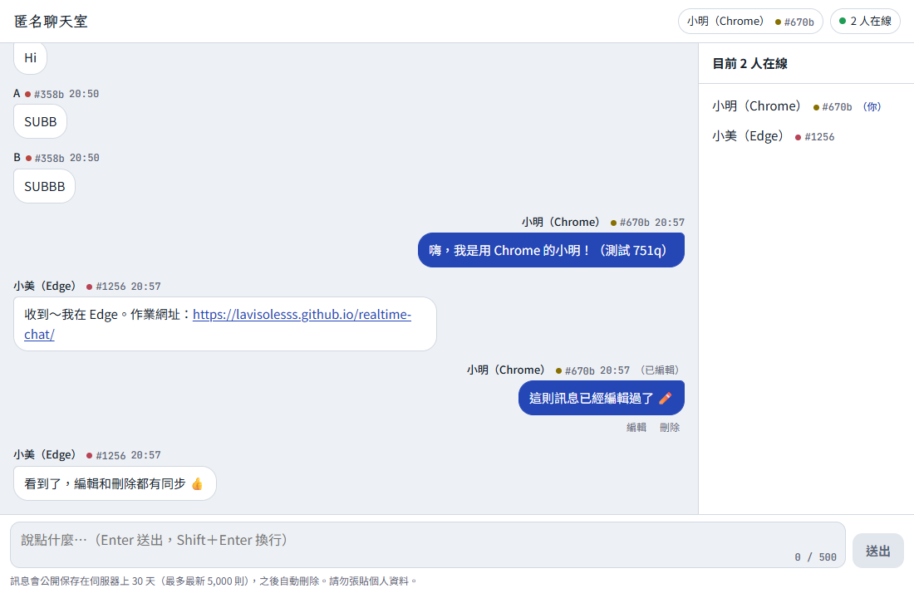
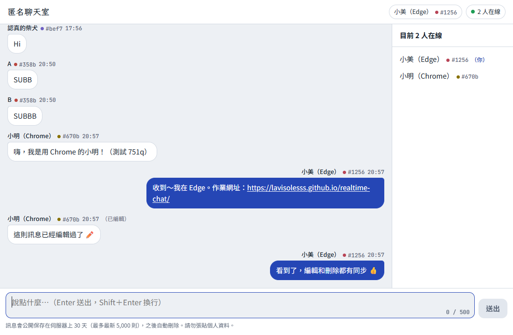

# realtime-chat

打開就能用的匿名即時聊天室。前端用 TypeScript + Vite（不用框架），部署在 GitHub Pages；階段二接上 Supabase。

- 網址：https://lavisolesss.github.io/realtime-chat/
- 架構文件：[docs/architecture.md](docs/architecture.md)
- 視覺設計：[docs/design.md](docs/design.md)

## 基本功能

- **進入畫面**：打開網址先輸入代號（暱稱，1～20 字），按「進入聊天室」才進到聊天室。
- **即時聊天**：訊息即時出現在所有人的畫面上，不同裝置、不同瀏覽器都可以互相收發。
- **在線名單**：顯示「N 人在線」和每個人的暱稱。

## 新增功能

除了基本的即時聊天，這個作業另外做了以下功能：

| 功能 | 說明 | 程式／設定位置 |
|---|---|---|
| **編輯／刪除自己的訊息**（B） | 自己的訊息下方有「編輯」「刪除」按鈕（電腦滑鼠移過去出現，手機點一下訊息出現）。編輯後所有人看到新內容並標示「（已編輯）」；刪除前會跳出確認視窗，刪除後所有人畫面上的那則訊息同時消失。只能改自己的訊息，資料庫的 RLS 規則也會擋住修改別人訊息的請求 | `src/ui/message-item.ts`、`src/ui/dialogs.ts`、`supabase/migrations/001_init.sql` 第 3、4 段 |
| **資料庫 1 秒發送限制**（C） | 同一個人 1 秒內不能送第二則。前端會先擋並提示「送太快了」，但真正的防線在資料庫：觸發器（trigger）檢查同一個身分 1 秒內有沒有送過，有就拒絕，所以就算繞過網頁直接呼叫 Supabase 也無法洗版 | `supabase/migrations/001_init.sql` 第 2 段、`src/lib/rate-limit.ts` |
| **Supabase 匿名登入＋伺服器產生的辨識碼**（C） | 不用註冊，進入時用 Supabase 匿名登入取得身分。暱稱後面的 4 碼辨識碼（例如「小明 #a3f9」）由**資料庫**根據登入身分算出來，送出時間、身分編號也由伺服器填入，前端送什麼都不算數，所以無法冒充別人 | `src/transport/supabase-transport.ts`、`supabase/migrations/001_init.sql` 第 2 段 |
| **改暱稱同步** | 點上方自己的名字可以改暱稱，所有人的在線名單會立刻更新成新名字；之後的訊息用新暱稱，舊訊息保留當時的名字，辨識碼不變 | `src/ui/dialogs.ts`、`src/state/store.ts` |
| **載入更早的訊息** | 一開始只載入最近 50 則，往上捲到頂端會自動再載入更早的 50 則，直到「已經是最早的訊息」 | `src/ui/message-list.ts`、`src/transport/supabase-transport.ts` |
| **網址轉連結** | 訊息裡的 `http://`、`https://` 網址會變成可以點的連結，在新分頁開啟；`javascript:` 之類的危險連結一律當純文字 | `src/lib/linkify.ts` |
| **斷線自動重連** | 斷線時顯示「連線中斷，正在重新連線…」，連回來後自動補上斷線期間的新訊息、編輯和刪除 | `src/transport/supabase-transport.ts`、`src/state/store.ts` |
| **訊息保存期限** | 訊息最多保存 30 天、最新 5,000 則，由 pg_cron 每天自動清除；畫面上會告訴使用者訊息會被保存多久 | `supabase/migrations/002_retention.sql`、架構文件第 9.4 節 |

## 跨瀏覽器測試

2026-10-14 用 **Chrome** 和 **Edge** 兩個不同的瀏覽器同時連上同一個 Supabase，各自輸入代號進入聊天室後互相收發訊息（用 Puppeteer 自動操作，兩個瀏覽器是完全分開的身分）：

| 測試項目 | 結果 |
|---|---|
| 兩邊都看到「2 人在線」，在線名單有對方的名字 | ✅ |
| Chrome 送出 → Edge 即時收到 | ✅ |
| Edge 送出 → Chrome 即時收到 | ✅ |
| 訊息裡的網址在對方畫面變成可點的連結 | ✅ |
| Chrome 編輯訊息 → Edge 看到新內容和「（已編輯）」 | ✅ |
| Chrome 刪除訊息 → 兩邊畫面上的訊息都消失 | ✅ |

| Chrome（小明） | Edge（小美） |
|---|---|
|  |  |

Chrome 的截圖中，滑鼠停在自己的訊息上，所以看得到「編輯」「刪除」按鈕；另一則訊息標示「（已編輯）」。Edge 收到的網址是藍色底線的連結。

## 本機開發

需要 Node.js 20 以上。

```
npm install
npm run dev       # 開發用，改程式會自動更新畫面
npm run build     # 型別檢查＋打包到 dist/
npm run preview   # 預覽打包後的結果
```

開發網址是 `http://localhost:5173/realtime-chat/`（`npm run preview` 是 4173 port）。

## 目前進度：階段二（已接上 Supabase）

- 訊息存在 Supabase，不同裝置可以即時聊天。資料庫設定在 `supabase/migrations/`：`001_init.sql`（資料表、權限、防洗版）、`002_retention.sql`（訊息保存 30 天）。
- 本機開發要接 Supabase：把 `.env.example` 複製成 `.env.local` 並填入 Project URL 和 publishable key（`.env.local` 不會被 commit）。
- 沒有設定時會自動進入示範模式：訊息存在這個瀏覽器裡，同一個瀏覽器開兩個分頁就能互相聊天。
