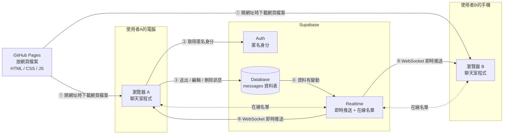
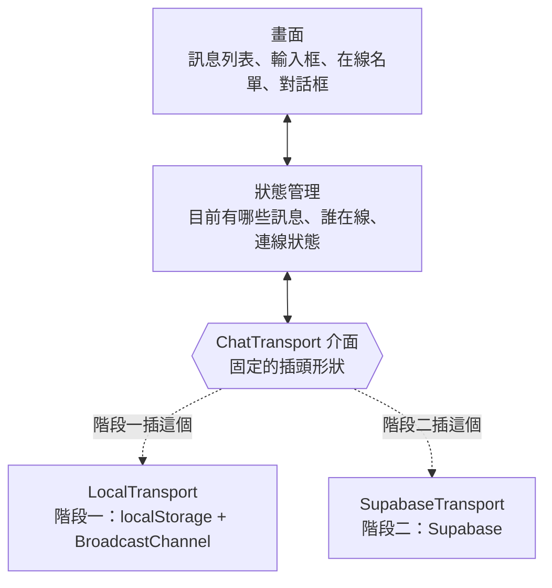
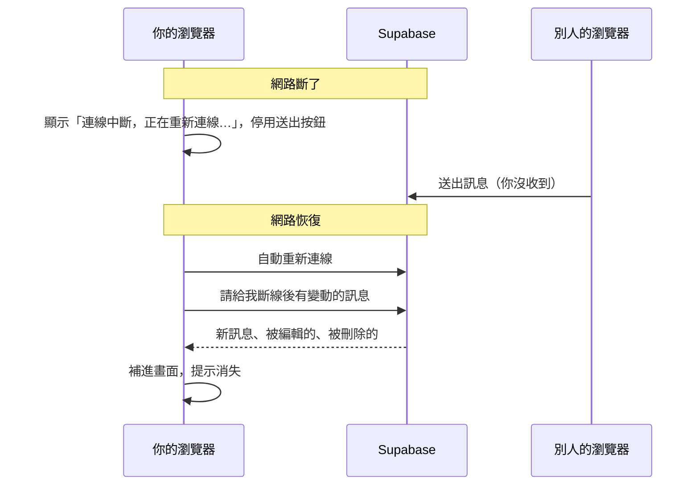
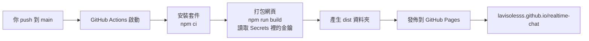

# 匿名即時聊天室：架構文件

> 這份文件寫給「不寫程式、但要看懂整個專案」的人。專有名詞第一次出現時，會用一句話解釋。
> 需求來源：[`docs/requirements.md`](requirements.md)，以及 grilling 問答整理出的共識（見第 1 節）。

---

## 1. 專案說明與目標

### 一句話說明

一個打開網址就能用的匿名聊天室：不用註冊，先輸入一個代號（暱稱）、按「進入」就能聊天，訊息會即時出現在所有人的畫面上。

### 目標

1. **零門檻**：打開網址就直接進聊天室，不用註冊、不用登入。
2. **即時**：別人送出的訊息，不用重新整理就會出現在你的畫面上。
3. **免費部署**：網頁放在 GitHub Pages，後端用 Supabase 免費方案。
4. **分兩階段完成**：先做出「看得到、摸得到」的示範版（階段一），再接上真正的伺服器（階段二），而且前端不用重寫。

### 需求共識（grilling 結果）

| # | 主題 | 決定 |
|---|---|---|
| 1 | 進入流程 | 打開網址先看到進入畫面：輸入代號、按「進入聊天室」才進聊天室（不會自動指定暱稱；可按「隨機產生」幫忙想一個）。進來後可隨時改暱稱 |
| 2 | 舊訊息 | 進來時顯示最近 50 則，捲到頂端可以再載入更早的 |
| 3 | 在線狀態 | 顯示「目前 N 人在線」並列出在線者暱稱，進出時不跳提示 |
| 4 | 訊息內容 | 純文字，最多 500 字，可用 emoji；`http`／`https` 網址自動變成連結，在新分頁開啟 |
| 5 | 修改訊息 | 可以編輯（標示「已編輯」）或刪除自己的訊息，所有人畫面同步。「自己」綁在目前的瀏覽器上 |
| 6 | 防洗版 | 每則訊息之間至少隔 1 秒，太快時送出按鈕變灰並提示「送太快了，請稍等」 |
| 7 | 暱稱 | 1～20 個字，可以重複，後面自動加固定辨識碼（例如「小明 #a3f9」）；改名後舊訊息保留原名 |
| 8 | 斷線 | 上方顯示「連線中斷，正在重新連線…」，期間不能送出；連回後自動補上漏掉的訊息 |
| 9 | 階段一 | 訊息存在自己的瀏覽器，同一台電腦開兩個分頁可以互相聊天，畫面標示「示範模式」 |
| 10 | 裝置 | 手機和電腦都能用 |
| 11 | 時間 | 顯示「時:分」，跨日插入日期分隔線 |
| 12 | 自動捲動 | 正在看舊訊息時不會被拉走，改顯示「↓ 有 N 則新訊息」 |
| 13 | 檢舉／封鎖 | 這一版不做 |
| 14 | 語言 | 繁體中文 |

---

## 2. 整體架構圖

先認識三個角色：

- **瀏覽器**：使用者用來開網頁的程式（Chrome、Safari 等）。聊天室的程式其實是在每個人自己的瀏覽器裡執行。
- **GitHub Pages**：GitHub 提供的免費網頁空間。它只負責「把網頁檔案交給瀏覽器」，不會處理訊息。
- **Supabase**：一個線上的後端服務，幫我們保管訊息（資料庫）、把新訊息即時推給大家（Realtime），並發給每個訪客一個匿名身分（Auth）。



**訊息怎麼從你的瀏覽器跑到別人的瀏覽器：**

1. 你打開網址，GitHub Pages 把網頁檔案交給你的瀏覽器（之後 GitHub Pages 就沒事了）。
2. 你的瀏覽器向 Supabase 要一個匿名身分，像是領一張沒有名字的號碼牌。
3. 你按送出，瀏覽器把訊息存進 Supabase 的資料庫。
4. 資料庫一有新資料，Supabase Realtime 立刻知道。
5. Realtime 透過 **WebSocket**（瀏覽器和伺服器之間一條一直開著的電話線，伺服器可以隨時主動講話）把訊息推給所有開著聊天室的瀏覽器，包括你自己的。

> 重點：**GitHub Pages 和 Supabase 之間沒有直接連線**。兩者都只跟瀏覽器打交道。

---

## 3. 技術選擇

### 3.1 前端語言：TypeScript

- **選了什麼**：**TypeScript**，一種「多了型別檢查的 JavaScript」。瀏覽器只看得懂 JavaScript，TypeScript 寫完會先轉成 JavaScript 再上線。
- **為什麼**：
  - 第 5 節的「通訊約定」（訊息長什麼樣子）可以直接寫成 TypeScript 的型別。只要有人把欄位名稱打錯，還沒上線就會被抓出來。
  - 階段一換到階段二時，型別檢查會告訴我們「哪些地方還沒改好」，降低改壞的機會。

### 3.2 前端框架：不用框架（原生 DOM），搭配 Vite 打包

- **選了什麼**：
  - **不使用 React、Vue 這類框架**。框架是一套「幫你管理畫面更新」的大型工具組；我們直接用瀏覽器內建的方法（DOM，瀏覽器操作網頁元素的標準方式）。
  - 用 **Vite** 當打包工具。打包工具會把我們分成很多檔案的程式整理成瀏覽器能直接讀的少數幾個檔案，開發時也能即時預覽。
- **為什麼**：
  - 這個聊天室只有一個主畫面加兩三個小視窗，規模小，框架帶來的好處不明顯，反而多一層要學的東西。
  - 不用框架，最後產生的檔案很小，手機打開也快。
  - Vite 設定簡單、速度快，產出的就是 GitHub Pages 能直接放的靜態檔案（不需要伺服器執行程式的檔案）。
  - 需要 Node.js 20 以上才能執行 Vite（P0 已經裝好）。

### 3.3 Supabase 用到的功能

| 功能 | 一句話解釋 | 用在哪裡 | 為什麼選它 |
|---|---|---|---|
| **Database**（PostgreSQL） | 一個存資料的表格系統，PostgreSQL 是它的資料庫軟體 | 保存所有訊息（`messages` 資料表） | 訊息要能「之後再載入更早的」、斷線後要補資料，所以一定要存起來 |
| **Realtime：Postgres Changes** | 資料庫一有新增、修改，就自動透過 WebSocket 通知訂閱的人 | 新訊息、編輯、刪除即時同步 | 「存資料」和「通知大家」是同一個動作，不會發生「大家看到了但其實沒存進去」的狀況 |
| **Realtime：Presence** | 追蹤「現在誰連著線」的功能，有人進出會自動更新名單 | 在線人數和在線名單 | 專門為在線名單設計，關掉分頁或斷線會自動從名單消失 |
| **Auth：Anonymous Sign-ins（匿名登入）** | 不用帳號密碼，就給每個訪客一個獨一無二的身分編號 | 判斷「這則訊息是不是你的」，決定你能不能編輯或刪除 | 需求要「可以編輯、刪除自己的訊息」，但又不要註冊。匿名登入剛好兩者兼顧，使用者完全感覺不到登入這件事 |
| **Row Level Security（RLS，資料列層級權限）** | 在資料庫裡設定規則，例如「只有寫這則訊息的人可以改它」 | 決定誰能讀、誰能送、誰能改：只有登入（含匿名登入）的人能讀和送，只有作者能改自己的訊息 | 前端的檢查可以被繞過，RLS 是在 Supabase 那一端把關，才是真正的防線 |
| **觸發器（Trigger）與檢查規則（Check constraint）** | 觸發器是「資料寫進去之前自動執行的小程式」；檢查規則是「資料必須符合的條件」 | 防洗版（1 秒限制）、由伺服器填入身分／辨識碼／時間、字數與空白檢查、不能改暱稱和送出時間 | 這些規則跟「誰能做」無關，而是「資料必須長什麼樣子」，所以放在觸發器和檢查規則，而不是 RLS |

**為什麼不用 Realtime 的 Broadcast（廣播）功能來傳訊息？** Broadcast 只負責傳話，不會存檔。我們需要「進來時看到舊訊息」和「斷線後補資料」，所以選擇「先存資料庫，再由資料庫通知大家」的 Postgres Changes。

---

## 4. 兩個階段

### 4.1 階段一：還沒接 Supabase

**能做到的：**

- 打開網址先在進入畫面輸入代號、按「進入聊天室」，進去後名字顯示為「代號 #a3f9」。
- 送出訊息、編輯、刪除自己的訊息、改暱稱。
- 訊息存在**自己瀏覽器的 localStorage**（瀏覽器內建的小儲存空間，關掉網頁再打開資料還在）。重新整理後訊息還在。
- 身分和暱稱存在**每個分頁自己的 sessionStorage**（只屬於這一個分頁的儲存空間，重新整理還在，關掉分頁就消失）。所以同一個瀏覽器開兩個分頁，會是兩個不同的人，才能模擬兩個人聊天。階段二改存在 localStorage，同一個瀏覽器就是同一個人。
- **同一台電腦、同一個瀏覽器開兩個分頁**，兩邊會即時互相看到對方的訊息、在線名單顯示 2 人。這是用瀏覽器內建的 **BroadcastChannel**（同一個瀏覽器裡、不同分頁之間互相傳話的管道）做到的。
- 舊訊息分批載入、時間與日期分隔線、「↓ 有 N 則新訊息」、防洗版、500 字限制、網址變連結，全部都能測。
- 畫面上方固定顯示「**示範模式：訊息只存在你的瀏覽器，不會傳給其他人**」。

**做不到的：**

- 不同電腦、不同人之間**無法**互相聊天。你朋友打開你的網址，只會看到他自己的示範聊天室。
- 「斷線重連」無法真正測試，因為分頁之間的傳話不需要網路。

**怎麼在 GitHub Pages 上看到效果：** 程式 push 到 GitHub 後，GitHub Actions 會自動打包並發佈（見第 12 節）。打開 `https://lavisolesss.github.io/realtime-chat/` 就能看到示範模式。開第二個分頁，就能模擬兩個人聊天。

### 4.2 階段二：接上 Supabase 之後

**改變的地方：**

| 項目 | 階段一 | 階段二 |
|---|---|---|
| 訊息存在哪 | 自己瀏覽器的 localStorage | Supabase 資料庫 |
| 訊息怎麼傳給別人 | BroadcastChannel（只限同一瀏覽器的分頁） | Supabase Realtime（WebSocket，全世界都收得到） |
| 在線名單 | 同一瀏覽器的分頁互相回報 | Supabase Presence |
| 「我是誰」 | 隨機編號存在 sessionStorage（每個分頁各自一個身分） | Supabase 匿名登入的身分編號，暱稱存在 localStorage |
| 防洗版、字數限制 | 只有前端擋 | 前端擋 + Supabase 資料庫再擋一次 |
| 「示範模式」標示 | 顯示 | 不顯示 |
| 斷線重連 | 不適用 | 顯示提示、自動重連、補上漏掉的訊息 |

**Supabase 設定步驟（階段二開始時照做）：**

1. 登入 [supabase.com](https://supabase.com)（可用 GitHub 帳號），按 **New project**。
   - 名稱：`realtime-chat`
   - Database Password：按 Generate 產生一組，**存進你的密碼管理器**（這個專案的程式用不到它，但之後管理資料庫可能需要）。
   - Region：選離台灣近的，例如 **Northeast Asia (Tokyo)** 或 **Southeast Asia (Singapore)**。目前的專案在 **Southeast Asia (Singapore)**（代號 `ouqhxwaevsrgppvcfzii`）。
2. **Authentication → Sign In / Providers**：打開 **Allow anonymous sign-ins**（允許匿名登入）。
3. **SQL Editor**：貼上 repo 裡 `supabase/migrations/` 的 SQL 檔並執行。它會建立 `messages` 資料表、RLS 規則、防洗版規則，並開啟這張表的 Realtime。（這個檔案在階段二由 Claude Code 寫好。）

> 實際設定時，第 2、3 步是用一個暫時的 Supabase 個人存取權杖，透過 Supabase 管理 API 完成的（沒有使用 Supabase CLI）。權杖用完已經刪除。以後要改資料庫，用上面的 SQL Editor 手動執行新的 migration 檔即可。
4. **Project Settings → API Keys**：抄下 Project URL 和 publishable key（見第 8 節），放進本機的 `.env.local` 和 GitHub 的 Secrets。

### 4.3 怎麼設計，才不用整個重寫

關鍵是把「**傳送訊息的方式**」和「**畫面**」完全分開，中間用一個固定的介面（介面：雙方事先講好的插頭形狀）接起來。



- **畫面**只跟**狀態管理**打交道，完全不知道訊息是從分頁還是從 Supabase 來的。
- **ChatTransport 介面**規定了所有傳送方式都必須提供的動作：連線、載入最近訊息、載入更早訊息、送出、編輯、刪除、更新暱稱，以及第 5 節列出的事件。
- 階段一寫 `LocalTransport`，階段二再寫 `SupabaseTransport`，兩個都長成同樣的插頭形狀。
- **自動切換**：程式啟動時檢查有沒有設定 Supabase 的網址和金鑰。有就用 `SupabaseTransport`，沒有就用 `LocalTransport` 並顯示「示範模式」。所以進入階段二時，畫面相關的程式**一行都不用改**，只要新增 `SupabaseTransport` 並設定金鑰。

---

## 5. 通訊約定

「通訊約定」就是事先規定好：發生什麼事時叫什麼名字、資料長什麼樣子。不管是階段一還是階段二，都遵守同一份約定。

### 5.1 資料格式

**訊息（Message）**

| 欄位 | 型別 | 說明 | 範例 |
|---|---|---|---|
| `id` | 文字（UUID，一種幾乎不會重複的隨機編號） | 訊息編號 | `"6f1c…"` |
| `userId` | 文字（UUID） | 送出者的身分編號 | `"a3f9…"` |
| `nickname` | 文字，1～20 字 | 送出**當時**的暱稱 | `"小明"` |
| `tag` | 文字，4 個英數字 | 辨識碼，由 `userId` 推算出來，同一人永遠相同 | `"a3f9"` |
| `content` | 文字，1～500 字 | 訊息內容；已刪除時為空字串 | `"大家好 👋"` |
| `createdAt` | 時間（ISO 8601 格式，國際標準的時間寫法） | 送出時間，由伺服器決定 | `"2026-10-13T06:05:00Z"` |
| `editedAt` | 時間或 `null`（`null` 表示「沒有」） | 最後編輯時間；沒編輯過是 `null` | `null` |
| `deletedAt` | 時間或 `null` | 刪除時間；沒刪除是 `null` | `null` |
| `updatedAt` | 時間 | 最後一次變動（新增、編輯、刪除）的時間，斷線補資料時使用 | `"2026-10-13T06:05:00Z"` |

> 資料庫裡的欄位名稱用底線寫法（`user_id`、`created_at`…），前端程式裡用駝峰寫法（`userId`、`createdAt`…），由 `SupabaseTransport` 負責轉換。

**在線者（PresenceUser）**

| 欄位 | 型別 | 說明 |
|---|---|---|
| `userId` | 文字 | 身分編號 |
| `nickname` | 文字 | 目前的暱稱 |
| `tag` | 文字 | 辨識碼 |
| `onlineAt` | 時間 | 這次上線的時間 |

> 同一個人開好幾個分頁，在線名單裡只算一個人（用 `userId` 合併）。

**連線狀態（ConnectionStatus）**：`"connecting"`（連線中）、`"online"`（已連線）、`"reconnecting"`（斷線、重連中）。

### 5.2 事件名稱

ChatTransport 會發出這些事件給狀態管理：

| 事件名稱 | 什麼時候發生 | 附帶的資料 |
|---|---|---|
| `message:new` | 有人（包括自己）送出新訊息 | 一則 Message |
| `message:updated` | 有人編輯了訊息 | 更新後的 Message |
| `message:deleted` | 有人刪除了訊息 | 被刪的訊息 `id` |
| `presence:sync` | 在線名單有變化 | 全部在線者的清單（PresenceUser 陣列） |
| `connection:status` | 連線狀態改變 | ConnectionStatus |
| `error` | 保留給「不是因為使用者動作而發生」的錯誤；目前兩種 Transport 都沒有用到 | 錯誤代碼與給使用者看的中文說明 |

**動作失敗時**（例如送太快被伺服器擋下）：不是發出 `error` 事件，而是讓那個動作（`send`、`edit`、`remove`…）直接失敗，並帶著下面的錯誤代碼（程式裡叫 `ChatError`）。狀態管理收到後，在輸入框上方顯示對應的中文提示。這樣「哪個動作失敗」很清楚，輸入框也知道要不要清空。

**錯誤代碼：**

| 代碼 | 給使用者看的訊息 |
|---|---|
| `rate_limited` | 送太快了，請稍等 |
| `too_long` | 訊息不能超過 500 字 |
| `empty` | 訊息不能是空的 |
| `not_owner` | 只能修改自己的訊息 |
| `offline` | 目前沒有連線，請稍後再試 |
| `unknown` | 發生錯誤，請再試一次 |

### 5.3 ChatTransport 提供的動作

| 動作 | 說明 |
|---|---|
| `mode` | 不是動作，而是一個標記：`demo`（示範模式，階段一）或 `live`（接上 Supabase）。畫面用它決定要不要顯示示範模式橫幅 |
| `signIn()` | 取得「我的身分編號」：階段一是存在分頁裡的隨機編號，階段二是 Supabase 匿名登入（已經登入過就沿用） |
| `on(事件, 處理方式)` | 訂閱第 5.2 節的事件 |
| `connect(我的身分)` | 開始連線、加入在線名單 |
| `loadRecent()` | 取得最近 50 則訊息（不含已刪除） |
| `loadBefore(最舊那則的時間與編號)` | 取得更早的 50 則 |
| `loadChangedSince(時間)` | 取得某個時間之後新增、編輯、刪除過的訊息（斷線補資料用） |
| `send(內容, 暱稱)` | 送出新訊息 |
| `edit(訊息編號, 新內容)` | 編輯自己的訊息 |
| `remove(訊息編號)` | 刪除自己的訊息 |
| `updatePresence(暱稱)` | 改暱稱後，更新在線名單上的名字 |
| `disconnect()` | 離開 |

---

## 6. 資料流

### 6.1 進入聊天室

1. 瀏覽器從 GitHub Pages 下載網頁。
2. 顯示**進入畫面**（第 7.0 節）。每次打開網頁都會先停在這裡，不會直接進聊天室。
   - 上次用過的暱稱（階段一存在這個分頁的 sessionStorage，階段二存在 localStorage）會預填在輸入框，但仍然要按「進入聊天室」。
   - 沒存過就是空的輸入框；使用者自己輸入，或按「隨機產生」（「形容詞＋動物」，例如「匿名水獺」）。
   - 去掉前後空白後必須 1～20 字，否則「進入聊天室」不能按並顯示原因。
3. 按下「進入聊天室」（或按 Enter）後，把暱稱存起來，然後取得身分編號：
   - 階段一：沿用這個分頁存過的隨機編號，沒有就產生一個。
   - 階段二：向 Supabase 匿名登入（已登入過就沿用，Supabase 會自動把登入狀態存在 localStorage）。
   - 這一步失敗時留在進入畫面，顯示「連線失敗，請再按一次」。
4. 從身分編號推算 4 碼辨識碼，換成聊天主畫面。
5. 呼叫 `loadRecent()`，畫出最近 50 則訊息，捲到最底下。
6. 呼叫 `connect()`：開始接收即時事件，並把自己加入在線名單。
7. 連線狀態變成「已連線」，送出按鈕可以按。

### 6.2 送出訊息

1. 使用者在輸入框打字。字數計數器即時顯示「123 / 500」。
2. 按送出（或按 Enter；換行用 Shift＋Enter）。
3. 前端檢查：去掉前後空白後不是空的、不超過 500 字、距離上一則超過 1 秒。不通過就顯示提示，不送出。
4. 呼叫 `send()`：
   - 階段一：存進 localStorage，並透過 BroadcastChannel 告訴其他分頁。
   - 階段二：寫進 Supabase 的 `messages` 資料表。資料庫會**再檢查一次**字數和 1 秒限制，並由伺服器填入送出時間、身分編號和辨識碼（前端無法偽造）。
5. 所有連線中的畫面（包括自己）收到 `message:new`，把訊息加到列表最下面。
6. 送出成功後清空輸入框，送出按鈕變灰 1 秒。

### 6.3 編輯與刪除

- **編輯**：點自己訊息上的「編輯」→ 訊息變成可編輯的輸入框 → 按「儲存」→ `edit()` → 資料庫確認你是作者後才更新 → 所有人收到 `message:updated`，訊息內容換掉並標示「（已編輯）」。
- **刪除**：點「刪除」→ 跳出確認視窗「確定要刪除這則訊息嗎？」→ `remove()` → 資料庫確認你是作者後，把內容清空並記錄刪除時間 → 所有人收到 `message:deleted`，那則訊息從畫面上消失。
  - 為什麼是「清空內容」而不是把整筆資料刪掉？因為 Realtime 對「整筆刪除」能傳的資訊很有限，而且斷線的人回來時，需要知道「這則被刪了」才能把它從畫面移除。內容已經清空，所以被刪除的文字不會留在資料庫裡。

### 6.4 改暱稱

1. 點上方自己的名字 → 跳出改暱稱視窗。
2. 輸入新暱稱（去掉前後空白後 1～20 字）→ 儲存。
3. 新暱稱存起來（階段一存 sessionStorage，階段二存 localStorage），呼叫 `updatePresence()`，所有人的在線名單更新。
4. **之後**送出的訊息用新暱稱，舊訊息保留原名。辨識碼不變。

### 6.5 載入更早的訊息

1. 使用者往上捲到訊息列表頂端。
2. 頂端顯示「載入中…」，呼叫 `loadBefore()` 取得更早的 50 則。
3. 把它們加到列表上方，**畫面停在原本看的位置**，不會跳動。
4. 如果拿回來不到 50 則，代表已經到底了，頂端顯示「已經是最早的訊息」，不再載入。

### 6.6 離開

1. 使用者關掉分頁或離開網頁。
2. 連線中斷，Supabase Presence（階段一則是其他分頁）發現這個人不見了，就把他從在線名單移除，其他人收到 `presence:sync`。
3. 階段二：身分和暱稱還留在 localStorage，下次回來沿用（階段一關掉分頁就是新的人）。同一個身分才能繼續編輯、刪除以前的訊息。

### 6.7 斷線與重連（階段二）

1. 網路斷了 → 發出 `connection:status = reconnecting`。有兩種情況會發現斷線：瀏覽器自己通知「離線了」（最快），或 Supabase 的連線程式發現連線中斷。
2. 畫面上方出現「連線中斷，正在重新連線…」，送出、編輯、刪除按鈕暫時不能按。輸入框裡打到一半的字**保留**。
3. Supabase 的連線程式會自動嘗試重連，等待時間會慢慢拉長，避免一直狂連。如果網路已經恢復，但超過 **15 秒**還沒連上，程式會把即時頻道拆掉重建一次。
4. 重連成功 → 呼叫 `loadChangedSince(斷線前最後收到資料的時間)` → 把這段期間的新訊息補上，被編輯的換掉內容，被刪除的移除。比目前畫面上最舊那則還早的訊息就算被編輯了，也不會插進列表。
5. 重新加入在線名單 → 發出 `connection:status = online` → 提示消失，按鈕恢復。

> **第一次連線也會補一次資料。** 進入聊天室時是「先載入最近 50 則，再開始接收即時訊息」，這兩步之間如果剛好有人送出訊息，就會漏掉。所以每次「從沒連線變成已連線」（包括第一次），都會呼叫一次 `loadChangedSince`。



---

## 7. 畫面清單

> 這裡只規定「有什麼、會做什麼」。顏色、字型、間距、版面風格是下一步 `/design` 的工作。

整個聊天室有一個**進入畫面**、一個**主畫面**，加上幾個**小視窗**。

### 7.0 進入畫面

| 元素 | 行為 |
|---|---|
| 聊天室名稱「匿名聊天室」與一句說明 | 說明不用註冊、代號後面會加辨識碼 |
| 「你的代號」輸入框 | 1～20 字，前後空白會自動去掉；預填上次用過的暱稱，沒有就是空的（placeholder「例如：小明」）。打開時自動取得焦點 |
| 字數計數器「4 / 20」 | 即時更新，超過 20 變成警告樣式 |
| 「隨機產生」按鈕 | 填入一個「形容詞＋動物」的隨機暱稱，使用者仍要自己按進入 |
| 「進入聊天室」按鈕 | 不合規定時不能按並顯示原因（「暱稱不能是空的」／「暱稱最多 20 個字」）。按下或按 Enter 後顯示「進入中…」，成功就換成主畫面 |

### 7.1 主畫面

| 區塊 | 元素 | 行為 |
|---|---|---|
| **頂部列** | 聊天室名稱 | 固定文字 |
| | 我的暱稱＋辨識碼 | 點一下打開「改暱稱視窗」 |
| | 「目前 N 人在線」 | 點一下打開「在線名單」。電腦版可以直接常駐在畫面側邊 |
| **示範模式橫幅** | 「示範模式：訊息只存在你的瀏覽器，不會傳給其他人」 | 只在階段一顯示，不能關閉 |
| **連線狀態橫幅** | 「連線中斷，正在重新連線…」 | 只在重連中顯示，連回來後自動消失 |
| **訊息列表** | 頂端的「載入中…」或「已經是最早的訊息」 | 捲到頂端時自動載入更早的訊息 |
| | 日期分隔線，例如「10 月 13 日」 | 每天第一則訊息之前出現 |
| | 每則訊息：暱稱、#辨識碼、時間（時:分）、內容、「（已編輯）」 | 內容裡的 `http`／`https` 網址可以點，在新分頁開啟；長文字自動換行 |
| | 自己的訊息：「編輯」「刪除」按鈕 | 只出現在自己的訊息上。電腦上滑鼠移過去出現，手機上點一下訊息出現 |
| | 「↓ 有 N 則新訊息」按鈕 | 正在看舊訊息時有新訊息進來才出現，點一下捲到最底並消失 |
| | 空狀態：「還沒有人說話，來打個招呼吧！」 | 完全沒有訊息時顯示 |
| **輸入區**（固定在底部） | 保存提示「訊息會公開保存在伺服器上 30 天…」 | 輸入框下方的小字，示範模式不顯示（第 9.4 節） |
| | 多行輸入框 | Enter 送出，Shift＋Enter 換行。手機鍵盤彈出時不被擋住 |
| | 字數計數器「123 / 500」 | 超過 500 時變成警告樣式，並停用送出按鈕 |
| | 送出按鈕 | 空白、超過字數、冷卻 1 秒中、斷線中時不能按 |
| | 提示文字 | 例如「送太快了，請稍等」，幾秒後自動消失 |

### 7.2 改暱稱視窗

| 元素 | 行為 |
|---|---|
| 輸入框（預填目前的暱稱） | 1～20 字，前後空白會自動去掉 |
| 字數計數器「5 / 20」 | 即時更新 |
| 說明文字「你的辨識碼 #a3f9 不會改變」 | 讓使用者理解為什麼名字後面有一串字 |
| 「儲存」「取消」按鈕 | 不合規定時「儲存」不能按，並顯示原因 |

### 7.3 在線名單

| 元素 | 行為 |
|---|---|
| 標題「目前 N 人在線」 | 即時更新 |
| 名單：每人一行「暱稱 #辨識碼」 | 自己排第一個並標示「（你）」，其他人依上線時間排序 |
| 關閉按鈕 | 手機版是從側邊滑出的面板，按關閉或點外面收起 |

### 7.4 刪除確認視窗

| 元素 | 行為 |
|---|---|
| 「確定要刪除這則訊息嗎？刪除後無法復原。」 | — |
| 「刪除」「取消」按鈕 | 按刪除才真的刪 |

### 7.5 編輯模式（在訊息原位）

| 元素 | 行為 |
|---|---|
| 輸入框（預填原本的內容） | 規則跟送出時一樣：1～500 字 |
| 「儲存」「取消」按鈕 | Esc 等於取消；Enter 等於儲存（Shift＋Enter 換行，和輸入區一樣）；內容沒變或斷線時「儲存」不能按 |

---

## 8. 金鑰

**金鑰（API key）**：一串像密碼的文字，讓 Supabase 知道「是誰在跟它說話、可以做什麼」。

### 8.1 這個專案會碰到的金鑰

| 名稱 | 長什麼樣子 | 用途 | 可以公開嗎？ | 放在哪裡 |
|---|---|---|---|---|
| **Project URL** | `https://xxxx.supabase.co` | 你的 Supabase 專案網址 | ✅ 可以 | 本機 `.env.local`、GitHub Secrets，最後會出現在網頁程式裡 |
| **Publishable key**（舊版介面叫 **anon key**） | `sb_publishable_…`（舊版是 `eyJ…` 開頭的長字串） | 讓前端程式可以連到 Supabase | ✅ **可以**，它本來就是設計給前端用的 | 本機 `.env.local`、GitHub Secrets，最後會出現在網頁程式裡 |
| **Secret key**（舊版介面叫 **service_role key**） | `sb_secret_…`（舊版是 `eyJ…` 開頭） | 擁有**最高權限**，可以無視所有 RLS 規則 | ❌ **絕對不能** | **哪裡都不放**。這個專案用不到它，不要複製、不要貼到任何檔案、聊天室或截圖裡 |
| **Database password** | 你建立專案時產生的密碼 | 直接管理資料庫 | ❌ 不能 | 只放在你的密碼管理器。這個專案的程式用不到 |

### 8.2 為什麼 publishable key 公開了也沒關係？

publishable key 的權限，完全由我們在資料庫設定的 **RLS 規則**決定。就算有人從網頁裡把它挖出來，他能做的事也跟一般訪客一模一樣：讀訊息、用自己的匿名身分送訊息、改自己的訊息。他**不能**改別人的訊息、不能繞過 1 秒限制、不能刪資料表。

所以真正要保護的不是 publishable key，而是**把 RLS 規則寫對**，以及**絕對不要外流 secret key**。

### 8.3 怎麼產生

1. 建立 Supabase 專案後，Project URL 和金鑰會自動產生。
2. 在 Supabase 後台 **Project Settings → API Keys** 可以找到 publishable key。
3. 如果不小心外流了 secret key，到同一頁按 **Revoke / Roll** 作廢並換一把新的。

### 8.4 放在哪裡

**你的電腦上：`.env.local` 檔案**（放在 repo 根目錄）

```
VITE_SUPABASE_URL=https://xxxx.supabase.co
VITE_SUPABASE_PUBLISHABLE_KEY=sb_publishable_xxxx
```

- 變數名稱前面加 `VITE_`，是 Vite 的規定：只有 `VITE_` 開頭的變數才會被放進網頁程式裡。這也是一道保險，其他名稱的變數不會不小心被打包出去。
- repo 裡會有一個 `.env.example`，內容是同樣的變數名稱但值是空的，告訴別人「要填哪些東西」。這個檔案**會**被 commit，因為裡面沒有真的金鑰。

**GitHub 上：Repository Secrets**

- 到 repo 的 **Settings → Secrets and variables → Actions → New repository secret**，新增 `VITE_SUPABASE_URL` 和 `VITE_SUPABASE_PUBLISHABLE_KEY`。
- GitHub Actions 打包網頁時會讀這兩個值（見第 12 節）。
- 這兩個值最後還是會出現在公開的網頁程式裡（這是正常的，第 8.2 節解釋過），放在 Secrets 是為了**不讓它們出現在 repo 的程式碼和 commit 紀錄裡**，以後要換金鑰也只要改一個地方。

### 8.5 怎麼避免金鑰被 commit 到 GitHub

1. **`.gitignore` 已經擋住了**：`.gitignore` 是一份「git 要假裝看不到的檔案」清單。我們的 `.gitignore` 裡有 `.env` 和 `.env.*`（所有 `.env` 開頭的檔案），只放行 `.env.example`。所以 `.env.local` 不會被 `git add` 加進去。
2. **CLAUDE.md 裡明文規定**：Claude Code 不可以 commit 任何金鑰檔案。
3. **commit 前看一眼**：執行 `git status`，確認清單裡沒有 `.env.local`。
4. **GitHub 的保護**：GitHub 的 Push Protection（推送保護）會擋下含有已知格式金鑰的 push。這是最後一道防線，不能只靠它。
5. **萬一真的 commit 上去了**：**立刻到 Supabase 作廢那把金鑰並換新的**。只把檔案刪掉沒有用，因為 git 的歷史紀錄裡還找得到。

---

## 9. 安全與限制

### 9.1 別人可能送進來的奇怪東西，以及怎麼擋

| 奇怪的東西 | 會造成什麼問題 | 前端怎麼擋 | Supabase 怎麼擋 |
|---|---|---|---|
| **HTML 或程式碼**，例如 `<script>…</script>`、`` | **XSS 攻擊**（跨站腳本攻擊：讓別人的瀏覽器執行惡意程式，例如偷走身分） | 所有訊息和暱稱一律當「純文字」顯示（使用 `textContent`），瀏覽器只會把它當成一般字，不會執行。**程式裡禁止用 `innerHTML` 顯示使用者的內容** | — |
| **惡意連結**，例如 `javascript:alert(1)` | 點了會執行程式 | 只有 `http://` 和 `https://` 開頭的才變成連結，其他一律當純文字；連結加上 `rel="noopener noreferrer nofollow"` 和 `target="_blank"`，讓新分頁無法反過來控制聊天室分頁 | — |
| **超長訊息** | 洗版、占空間 | 超過 500 字不能送出 | 資料庫規定內容最多 500 字，超過就拒絕 |
| **空白訊息**（只有空白或換行） | 洗版 | 去掉前後空白後是空的就不能送 | 資料庫同樣檢查 |
| **超長暱稱、空白暱稱** | 版面爆掉 | 去掉前後空白後必須 1～20 字 | 資料庫規定暱稱 1～20 字 |
| **方向控制字元**（例如把文字反過來顯示的隱藏字元）、**零寬字元** | 偽造看起來一樣的暱稱、把版面弄亂 | 送出前移除，而且**顯示前再移除一次**：別人可能繞過網頁直接呼叫 Supabase，所以從伺服器收到的訊息和暱稱都不能信任 | — |
| **大量換行** | 一則訊息佔滿整個畫面 | 連續換行最多保留 2 個；過長的訊息顯示時可以設最大高度 | — |
| **狂送訊息** | 洗版、吃光免費額度 | 每則間隔至少 1 秒 | 資料庫檢查「同一個身分 1 秒內不能送第二則」，太快就拒絕 |
| **冒充別人**，例如取一樣的暱稱 | 誤導其他人 | 名字後面一定顯示辨識碼 | 辨識碼由伺服器根據身分編號算出來，前端無法偽造 |
| **修改、刪除別人的訊息** | 竄改對話 | 別人的訊息不顯示編輯、刪除按鈕 | RLS 規定只有作者可以改；身分編號、送出時間由伺服器填入，不能改 |
| **偽造送出時間** | 訊息排序錯亂 | — | 送出時間一律由伺服器決定 |

> **原則**：前端的檢查是為了「讓一般使用者有好的體驗」，Supabase 那一端的檢查才是「真正的安全防線」。懂技術的人可以完全不用我們的網頁，直接拿 publishable key 呼叫 Supabase，所以每一條重要規則都要在資料庫再擋一次。

### 9.2 免費方案的上限

> 以下數字以撰寫時的官方說明為準，**方案內容可能會變**，請以 [Supabase Pricing](https://supabase.com/pricing) 和 [GitHub Pages 文件](https://docs.github.com/pages/getting-started-with-github-pages/github-pages-limits) 為準。

**Supabase 免費方案（Free plan）**

| 限制 | 大約數字 | 對我們的影響 |
|---|---|---|
| **專案閒置會暫停** | 約 7 天沒有任何使用就自動暫停 | 很久沒人用時，聊天室會連不上。到 Supabase 後台按 **Restore** 就能恢復，資料不會不見 |
| 資料庫空間 | 500 MB | 純文字訊息很小，幾百萬則才會用完 |
| 同時連線數（Realtime） | 200 個 | 同時超過 200 人在線，後來的人會連不上 |
| Realtime 訊息量 | 每月 200 萬則 | 每則訊息要推給每個在線者。100 人在線時送 1 則，就算 100 則 |
| 資料傳輸量（Egress） | 每月 5 GB | 一般使用很難用完 |
| 匿名登入次數 | 預設每個 IP 每小時 30 次 | 同一個網路（例如學校教室）一小時內超過 30 個新訪客，後來的人可能登入失敗；可在後台 Rate Limits 調整 |
| 免費專案數量 | 2 個 | — |

**GitHub Pages**

| 限制 | 數字 |
|---|---|
| 網站大小 | 1 GB |
| 每月流量 | 約 100 GB（軟性上限） |
| repo 必須是 | Public（免費帳號） |

### 9.3 已知風險（這一版接受）

- **匿名登入可能被濫用**：有人可以用程式大量產生匿名身分。Supabase 建議加上 CAPTCHA（「我不是機器人」驗證），這一版先不做，靠「每個 IP 每小時 30 次」的預設限制擋著。
- **沒有內容審查**：有人罵髒話或貼不當內容時，只能由你到 Supabase 後台手動刪除。
- **辨識碼只有 4 碼**：兩個不同的人有極小的機會拿到一樣的辨識碼（約 6.5 萬分之一）。對小型聊天室來說可以接受。
- **`anon` 角色帶有資料表權限**：Supabase 會自動讓「沒登入」的 `anon` 角色擁有 `messages` 的讀寫權限（由內部的 `supabase_realtime_admin` 授予，我們的 SQL 收回不了）。實際上沒有影響，因為 RLS 的三條規則都只開放給登入的人，測試也確認沒登入的人讀不到、也送不出訊息。
- **訊息會被公開保存**：所有登入的人都讀得到全部訊息，訊息存在 Supabase 的伺服器上。保存多久、怎麼清除見第 9.4 節。
- **匿名身分會累積**：每個新瀏覽器（或清掉資料、無痕視窗）都會產生一個新的匿名身分，留在 Supabase 的使用者清單裡。免費方案沒有數量上限，但之後可以考慮定期清掉很久沒用、也沒發過訊息的匿名身分。

### 9.4 訊息保存的限制

訊息寫進 Supabase 的 `messages` 資料表後，**如果什麼都不做就會永久保存**（使用者按「刪除」也只是清空內容，那一筆紀錄還在）。這對使用者的隱私不好，也會慢慢吃掉免費方案的 500 MB 空間，所以這一版定下保存規則：

| 規則 | 內容 |
|---|---|
| **保存多久** | 最多 **30 天**。送出超過 30 天的訊息（包含已刪除、只剩空殼的訊息）會被**整筆刪除** |
| **保存多少則** | 最多留**最新 5,000 則**。30 天內如果超過 5,000 則，更早的會先被刪除 |
| **怎麼清除** | 用 Supabase 內建的 **pg_cron**（資料庫裡的排程工具，免費方案就有）每天台灣時間凌晨 4:00 執行一次 `purge_old_messages()`。設定在 `supabase/migrations/002_retention.sql` |
| **誰能清除** | 只有排程（資料庫管理者）能執行；這個函式不開放給網頁上的使用者呼叫，RLS 也仍然不允許任何人整筆刪除訊息 |
| **告訴使用者** | 進入畫面和聊天畫面輸入框下方都顯示「訊息會公開保存在伺服器上 30 天（最多最新 5,000 則），之後自動刪除。請勿張貼個人資料。」；捲到最上面時顯示「已經是最早的訊息（只保留最近 30 天）」。示範模式訊息只存在瀏覽器裡，不顯示這段提示 |

補充說明：

- **為什麼是 30 天、5,000 則**：聊天室是即時聊天用的，不是長期存檔。30 天足夠回頭看最近的對話；5,000 則是防止有人短時間大量洗版時資料表無限長大。純文字訊息 5,000 則大約只佔幾 MB，遠低於 500 MB 上限。
- **清除不是即時的**：一天只跑一次，所以實際保存時間是 30～31 天。已經開著的聊天畫面不會因為清除而立刻少掉訊息，重新整理後才會看不到。
- **備份**：免費方案不提供自動備份可以還原，被清掉的訊息就找不回來了。
- **要改天數或則數**：同時改 `002_retention.sql`（新增一個 migration 重新定義函式）和 `src/types.ts` 的 `RETENTION_DAYS`、`RETENTION_MAX_MESSAGES`，畫面上的提示文字會跟著變。
- **專案暫停時**：Supabase 專案閒置被暫停（第 9.2 節）期間排程不會執行，恢復後下一次排程會一次清掉所有過期的訊息。

---

## 10. 這一版刻意不做的事

| 不做的事 | 為什麼 |
|---|---|
| 帳號註冊與登入 | 目標是零門檻匿名聊天，匿名登入已經足夠 |
| 多個聊天室 | 先把一個聊天室做好，資料表設計之後要加也不難 |
| 傳圖片或檔案 | 需要額外的儲存空間和內容審查，免費方案容量也有限 |
| 檢舉與封鎖 | 匿名環境裡難以可靠地封鎖同一個人（換瀏覽器就是新身分），需要另外設計 |
| 有人進出時的提示訊息 | 人多時會洗版，重新整理會產生「離開又加入」的雜訊；在線名單已經足夠 |
| 斷線時先排隊、連回來再送 | 會牽涉訊息順序錯亂、重複送出等問題 |
| 粗體、斜體等格式 | 需求只要純文字；格式化會增加 XSS 風險 |
| 「正在輸入…」提示 | 每次打字都要傳訊號，很快吃光 Realtime 額度 |
| 通知音效、桌面通知 | 不是核心功能，之後再加 |
| 跨裝置保留身分 | 匿名身分綁在瀏覽器上；要跨裝置就必須有帳號，與零門檻衝突 |
| 搜尋訊息 | 不是核心功能 |
| 多國語言 | 使用者都看繁體中文 |
| 人機驗證（CAPTCHA） | 增加使用門檻；先靠 Supabase 預設的次數限制，濫用時再加 |

---

## 11. repo 的資料夾結構

```
realtime-chat/
├── .github/
│   └── workflows/
│       └── deploy.yml            # 自動打包並發佈到 GitHub Pages
├── docs/
│   ├── requirements.md           # 需求說明
│   ├── architecture.md           # 這份文件
│   ├── design.md                 # 視覺設計規格（P5）
│   └── design-preview.html       # 可以操作的設計稿
├── src/                          # 所有程式碼
│   ├── main.ts                   # 程式起點：決定用哪個 Transport，啟動畫面
│   ├── config.ts                 # 讀取 Supabase 設定；沒有設定就是示範模式
│   ├── types.ts                  # 第 5 節的通訊約定（Message、事件、錯誤代碼）
│   ├── vite-env.d.ts             # 告訴 TypeScript 有哪些 VITE_ 環境變數
│   ├── transport/
│   │   ├── transport.ts          # ChatTransport 介面（插頭形狀）
│   │   ├── local-transport.ts    # 階段一：localStorage + BroadcastChannel
│   │   └── supabase-transport.ts # 階段二：Supabase（階段二才新增）
│   ├── state/
│   │   └── store.ts              # 狀態管理：訊息、在線名單、連線狀態
│   ├── ui/                       # 畫面元件
│   │   ├── dom.ts                # 建立畫面元素的小工具（一律用 textContent，不用 innerHTML）
│   │   ├── header.ts             # 頂部列
│   │   ├── banners.ts            # 示範模式、連線狀態橫幅
│   │   ├── message-list.ts       # 訊息列表、日期分隔線、新訊息按鈕
│   │   ├── message-item.ts       # 單則訊息、編輯模式
│   │   ├── composer.ts           # 輸入區
│   │   ├── online-list.ts        # 在線名單
│   │   ├── dialogs.ts            # 改暱稱、刪除確認視窗
│   │   └── entry.ts              # 進入畫面（輸入代號）
│   ├── lib/                      # 小工具
│   │   ├── identity.ts           # 身分、暱稱、隨機暱稱、辨識碼
│   │   ├── validate.ts           # 字數、空白、隱藏字元檢查
│   │   ├── linkify.ts            # 安全地把網址變成連結
│   │   ├── rate-limit.ts         # 1 秒冷卻
│   │   └── time.ts               # 時間與日期格式
│   └── styles.css                # 樣式（/design 之後決定內容）
├── supabase/
│   └── migrations/
│       ├── 001_init.sql          # 資料表、RLS、防洗版規則（階段二才新增）
│       └── 002_retention.sql     # 訊息保存期限：pg_cron 每天清除 30 天前的訊息
├── index.html                    # 網頁入口（網站小圖示直接寫在這裡，所以沒有 public/ 資料夾）
├── .env.example                  # 金鑰範本（空值，會 commit）
├── .env.local                    # 真正的金鑰（不會 commit，自己建立）
├── .gitignore
├── CLAUDE.md                     # 給 Claude Code 的工作規則
├── README.md
├── package.json                  # 專案設定與用到的套件清單
├── tsconfig.json                 # TypeScript 設定
└── vite.config.ts                # Vite 設定（包含 GitHub Pages 的網址路徑）
```

---

## 12. 部署到 GitHub Pages 的方式

**GitHub Actions**：GitHub 內建的自動化工具，可以設定「每次 push 就自動做某些事」。

### 流程



### 一次性設定

1. repo 的 **Settings → Pages → Build and deployment → Source** 選 **GitHub Actions**。
2. `vite.config.ts` 要設定 `base: '/realtime-chat/'`。因為網址是 `…github.io/realtime-chat/` 而不是網域根目錄，不設定的話網頁會找不到 CSS 和 JS 檔案。
3. （階段二）在 **Settings → Secrets and variables → Actions** 新增 `VITE_SUPABASE_URL` 和 `VITE_SUPABASE_PUBLISHABLE_KEY`。

### 日常使用

- push 到 `main` 就會自動部署，大約 1～2 分鐘後網址會更新。
- 進度可以在 repo 的 **Actions** 分頁看到。綠色勾勾代表成功，紅色叉叉點進去可以看錯誤訊息。
- **階段一不用設定 Secrets**：沒有金鑰時程式會自動進入示範模式，所以階段一就能部署。
- 這個 workflow 檔放在 `.github/workflows/`，所以 GitHub 登入需要 `workflow` 權限（P0 已確認）。

---

## 13. 驗證清單

### 13.1 階段一（示範模式）

**基本**

- [ ] `npm run dev` 可以在本機打開聊天室
- [ ] push 後 GitHub Actions 顯示綠色勾勾
- [ ] 打開 `https://lavisolesss.github.io/realtime-chat/` 看得到聊天室，沒有空白頁
- [ ] 上方顯示「示範模式」橫幅

**身分與暱稱**

- [ ] 打開網址先看到進入畫面，不會直接進聊天室
- [ ] 代號空白或超過 20 字時「進入聊天室」不能按；輸入代號後按「進入聊天室」（或 Enter）才進入，名字後面有 4 碼辨識碼
- [ ] 「隨機產生」會填入隨機暱稱，但仍要按進入
- [ ] 重新整理後回到進入畫面，代號已預填；進入後辨識碼不變
- [ ] 可以改暱稱；空白、超過 20 字時不能儲存
- [ ] 改暱稱後，舊訊息保留原名，新訊息用新名字，辨識碼不變

**訊息**

- [ ] 可以送出訊息，Enter 送出、Shift＋Enter 換行
- [ ] 空白訊息不能送出
- [ ] 字數計數器正確；超過 500 字不能送出
- [ ] 1 秒內連按兩次送出，第二次被擋下並顯示「送太快了，請稍等」
- [ ] 訊息顯示時:分；跨日時出現日期分隔線
- [ ] `https://example.com` 變成可點的連結，在新分頁開啟
- [ ] `javascript:alert(1)` **不會**變成連結
- [ ] 送出 `<script>alert(1)</script>` 和 ``：畫面原樣顯示這段文字，**不會**跳出視窗
- [ ] 重新整理後訊息還在

**編輯與刪除**

- [ ] 只有自己的訊息有編輯、刪除按鈕
- [ ] 編輯後顯示新內容和「（已編輯）」
- [ ] 刪除前跳出確認視窗；刪除後訊息消失

**兩個分頁互動**（同一個瀏覽器開兩個分頁）

- [ ] 一邊送出訊息，另一邊不用重新整理就看到
- [ ] 一邊編輯或刪除，另一邊同步更新
- [ ] 在線名單顯示正確人數和暱稱；關掉一個分頁後名單更新

**捲動與載入**

- [ ] 送出超過 50 則後重新整理：一開始只顯示最近 50 則，往上捲會載入更早的，畫面不跳動
- [ ] 載入到最早時顯示「已經是最早的訊息」
- [ ] 往上看舊訊息時，另一個分頁送訊息：畫面不會被拉走，出現「↓ 有 N 則新訊息」，點了會捲到底

**手機**

- [ ] 用手機打開 GitHub Pages 網址，版面正常、不用左右捲動
- [ ] 鍵盤彈出時看得到輸入框

### 13.2 階段二（接上 Supabase）

**設定與金鑰**

- [ ] Supabase 專案已建立，匿名登入已開啟，SQL 已執行
- [ ] 本機 `.env.local` 已填好；`git status` 看不到 `.env.local`
- [ ] GitHub Secrets 已新增兩個變數
- [ ] 搜尋整個 repo，找不到 secret key（`sb_secret_` 或 `service_role`）
- [ ] 打開網頁後**沒有**「示範模式」橫幅

**跨裝置即時聊天**

- [ ] 電腦和手機（或兩個不同的瀏覽器）可以互相即時看到訊息
- [ ] 編輯、刪除會同步到另一台裝置
- [ ] 在線名單正確顯示兩台裝置；同一個人開兩個分頁只算一人
- [ ] 關掉其中一台的分頁，另一台的在線名單在幾秒內更新
- [ ] 重新整理後看得到之前的訊息（資料存在 Supabase）

**訊息保存**

- [ ] 已在 SQL Editor 執行 `002_retention.sql`；`select * from cron.job;` 看得到 `purge-old-messages`
- [ ] 進入畫面和輸入框下方都看得到「訊息會公開保存在伺服器上 30 天…」

**身分**

- [ ] 重新整理後還是同一個身分，可以編輯以前的訊息
- [ ] 換一個瀏覽器（或無痕視窗）會變成新身分，不能編輯之前的訊息

**伺服器端防線**（請 Claude Code 協助測試，直接呼叫 Supabase，不透過網頁）

- [ ] 送出超過 500 字的訊息會被拒絕
- [ ] 1 秒內送兩則，第二則被拒絕
- [ ] 試圖修改、刪除別人的訊息會被拒絕
- [ ] 試圖偽造送出時間、身分編號、辨識碼無效

**斷線重連**

- [ ] 關掉 Wi-Fi（或在瀏覽器開發者工具切成 Offline）：出現「連線中斷，正在重新連線…」，送出按鈕不能按，打到一半的字還在
- [ ] 斷線期間用另一台裝置送訊息、編輯、刪除
- [ ] 恢復網路：提示消失，斷線期間的新訊息、編輯、刪除都正確補上

**部署**

- [ ] push 後 GitHub Actions 綠色勾勾，GitHub Pages 上的版本可以跨裝置聊天
